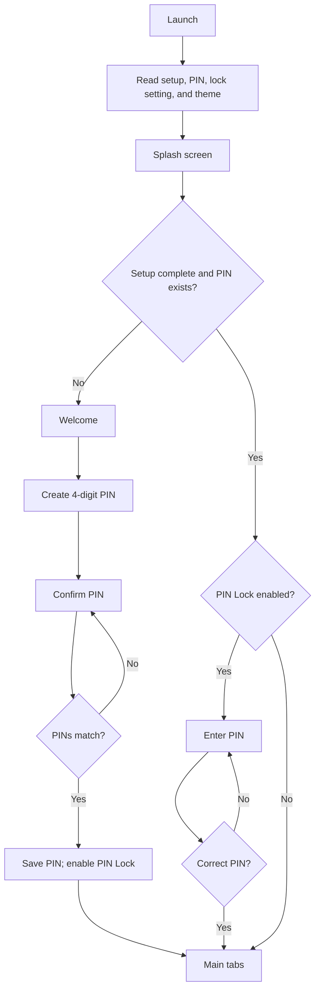
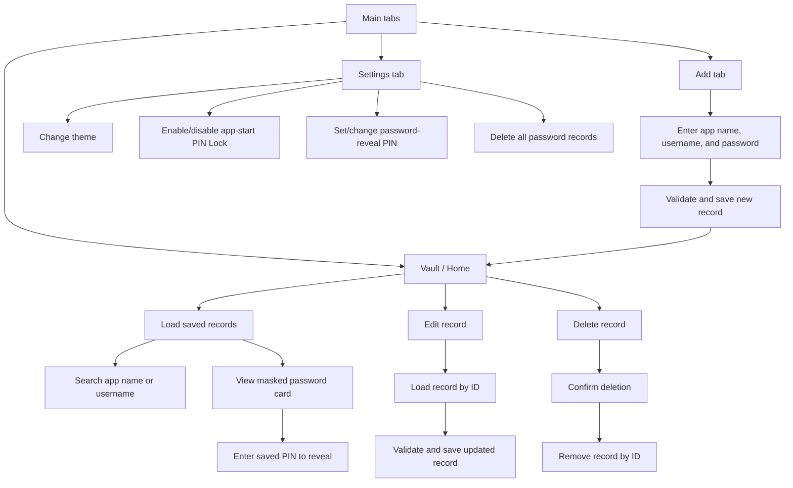

# Password Vault

An educational, offline password-reminder application built with Expo and React Native. It lets a user save login details on the current device, search and manage those entries, and gate app access or password reveals with a four-digit PIN.

> **Educational use only:** saved credentials and PINs are stored locally using AsyncStorage without encryption. The PIN is a basic in-app access check, not cryptographic protection or production-grade authentication. Do not store real or sensitive passwords in this application.

## Table of contents

- [Project overview](#project-overview)
- [Features and scope](#features-and-scope)
- [Technologies and tools](#technologies-and-tools)
- [Architecture and folder structure](#architecture-and-folder-structure)
- [Application flows](#application-flows)
- [Technical concepts in this project](#technical-concepts-in-this-project)
- [Data storage and flow](#data-storage-and-flow)
- [Security and privacy](#security-and-privacy)
- [Installation and setup](#installation-and-setup)
- [Web build and deployment](#web-build-and-deployment)
- [Testing and troubleshooting](#testing-and-troubleshooting)
- [Technical defense preparation](#technical-defense-preparation)
- [Limitations and future improvements](#limitations-and-future-improvements)
- [Glossary](#glossary)
- [Verified and unconfirmed details](#verified-and-unconfirmed-details)

## Project overview

### Purpose and problem statement

People may need a simple place to keep login reminders available without depending on a remote service. This project demonstrates how a cross-platform app can collect, display, search, and persist basic credential records locally. It is a learning exercise, not a secure password manager.

### Target users

The intended users are students and people experimenting with an offline password reminder. The app’s welcome screen and settings label it as an educational project. It should not be used to protect real credentials.

### Objectives

- Build a user interface for adding, viewing, editing, searching, and deleting login records.
- Persist records and app preferences on the device.
- Demonstrate component-based React Native development, typed navigation, asynchronous storage, form validation, and app themes.
- Provide basic PIN prompts while being transparent that they do not encrypt the vault.
- Support iOS, Android, and a web build through Expo and React Native Web.

## Features and scope

### Implemented

- Create and confirm a four-digit PIN during initial setup.
- Optionally require the saved PIN when the app opens; this lock can later be disabled in Settings.
- Require the saved PIN each time a user reveals a saved password on the Home screen.
- Add a record with an app/site name, username or email, and password.
- Mask passwords by default in both credential forms and saved cards; form inputs have a show/hide control.
- Browse saved records, search by app/site name or username, edit a record, and delete one after confirmation.
- Change light, dark, or system appearance.
- Delete all saved password records, or reset all vault/PIN/setup data from the “Forgot PIN?” flow.
- Display loading, empty, error, and retry states in relevant screens.

### Scope and exclusions

The application has no account registration, server, remote database, cross-device synchronization, password generator, password-strength checker, clipboard/copy action, or demonstrated biometric authentication. No cryptographic encryption is implemented. These are not implied by the word “vault” or by the UI’s password masking.

## Technologies and tools

The table describes the actual source and dependency manifest (`package.json`), not just packages available in the project.

| Technology | Purpose | Actual usage in this project |
|---|---|---|
| React 19 | Component rendering and local UI state | `App.tsx`, screens, reusable components, and `ThemeContext.tsx` |
| React Native 0.86 | Cross-platform UI primitives and styles | `View`, `Text`, `TextInput`, `Pressable`, `ScrollView`, `StyleSheet`, `Alert`, and other native UI in `src/` |
| Expo SDK 57 | App framework, development server, platform integration, and web export | `app.json`, `expo start` scripts, Expo splash/status-bar/symbol modules |
| TypeScript 6 / TSX | Static typing for app code and typed JSX | Most application code is `.ts`/`.tsx`; `tsconfig.json` enables strict mode |
| JavaScript (CommonJS) | Small Node-based project utility | `scripts/reset-project.js`; the app screens themselves are TypeScript/TSX |
| React hooks | Component state, lifecycle, memoization, context, and refs | `useState`, `useEffect`, `useCallback`, `useMemo`, `useContext`, `useRef`, `useColorScheme`, and React Navigation’s `useFocusEffect` |
| React Navigation 7 | Typed native-stack and bottom-tab navigation | `src/navigation/AppNavigator.tsx`; there is no Expo Router setup |
| AsyncStorage 2.2 | Asynchronous persistent key-value storage | `src/storage/vaultStorage.ts` stores serialized entries, PIN/setup flags, and theme preference |
| `react-native-safe-area-context` | Layout within device safe areas and tab-bar inset | `SafeAreaProvider`, `SafeAreaView`, and `useSafeAreaInsets` |
| `expo-splash-screen` | Controls the native splash screen during startup | `App.tsx` keeps it visible until settings load, then hides it |
| `expo-status-bar` | Status-bar appearance | `src/context/ThemeContext.tsx` selects a light or dark status bar style |
| `expo-symbols` | Platform-adaptive icons | `SymbolView` in `PasswordCard`, `PasswordInput`, `PinKeypad`, and `FloatingTabBar` |
| React Native `Animated` | Small press and splash animations | `src/components/FloatingTabBar.tsx` and `src/screens/SplashScreen.tsx` |
| React Native `StyleSheet` | Component styling | Screens and components define styles locally, often using the active theme colors |
| `react-native-web` and `react-dom` | Render React Native components in a browser | Declared runtime dependencies needed for Expo’s web target |
| npm and `package-lock.json` | Reproducible dependency installation | The repository includes `package-lock.json`; use `npm ci` |
| Expo CLI and ESLint | Development server and linting | `start`, `web`, `ios`, `android`, and `lint` scripts in `package.json` |

There is no separate styling framework or icon package used by the application source. `PasswordInput` and `PasswordCard` implement visibility behavior directly. PIN handling is project code in screens, `src/storage/vaultStorage.ts`, and `src/utils/validation.ts`; it is not an authentication provider.

Several other packages appear in `package.json` but were not found imported by the app source, including `@expo/ui`, `expo-device`, `expo-font`, `expo-glass-effect`, `expo-image`, `expo-linking`, `expo-system-ui`, and `expo-web-browser`. Their presence in the dependency list alone does not establish that the app uses their APIs.

## Architecture and folder structure

### Overview

The app uses a single root component, a typed React Navigation container, stack screens for setup and editing, and a bottom-tab navigator for the vault, add form, and settings. Shared UI is in `src/components/`; storage operations are centralized in `src/storage/vaultStorage.ts`; credential types and validation are separated into `src/types/` and `src/utils/`. Theme values are provided to screens through a React context.

### Repository tree

This tree is based on the tracked project files. Asset filenames are grouped for readability.

```text
.
├── App.tsx
├── app.json
├── package.json
├── package-lock.json
├── tsconfig.json
├── README.md
├── LICENSE
├── .gitignore
├── AGENTS.md
├── CLAUDE.md
├── .claude/
│   └── settings.json
├── .vscode/
│   ├── extensions.json
│   └── settings.json
├── scripts/
│   └── reset-project.js
├── src/
│   ├── components/
│   │   ├── BrandMark.tsx
│   │   ├── EmptyState.tsx
│   │   ├── FloatingTabBar.tsx
│   │   ├── PasswordCard.tsx
│   │   ├── PasswordInput.tsx
│   │   ├── PinKeypad.tsx
│   │   └── SearchBar.tsx
│   ├── context/
│   │   └── ThemeContext.tsx
│   ├── navigation/
│   │   └── AppNavigator.tsx
│   ├── screens/
│   │   ├── AddPasswordScreen.tsx
│   │   ├── ChangePinScreen.tsx
│   │   ├── ConfirmPinScreen.tsx
│   │   ├── CreatePinScreen.tsx
│   │   ├── EditPasswordScreen.tsx
│   │   ├── HomeScreen.tsx
│   │   ├── PinLockScreen.tsx
│   │   ├── SettingsScreen.tsx
│   │   ├── SplashScreen.tsx
│   │   └── WelcomeScreen.tsx
│   ├── storage/
│   │   └── vaultStorage.ts
│   ├── types/
│   │   └── PasswordEntry.ts
│   └── utils/
│       ├── theme.ts
│       └── validation.ts
├── assets/
│   ├── expo.icon/
│   └── images/
└── (no tracked ios/ or android/ directories)
```

The repository also contains `.gitignore`, `AGENTS.md`, `CLAUDE.md`, and `.claude/settings.json`. Generated `node_modules/`, `.expo/`, and `dist/` are excluded from version control by `.gitignore`. Native `ios/` and `android/` project directories are not present in the tracked tree.

### Key responsibilities

| File/folder | Responsibility |
|---|---|
| `App.tsx` | Loads persisted setup/PIN/theme values, decides the first navigation destination, creates the theme provider, and manages the native splash screen |
| `src/navigation/AppNavigator.tsx` | Defines typed route parameters, the native stack, and Home/Add/Settings bottom tabs |
| `src/screens/` | Implements the welcome, setup, lock, vault, add/edit, and settings flows |
| `src/components/` | Reusable credential card/input, PIN keypad, search bar, tab bar, brand mark, and empty state |
| `src/storage/vaultStorage.ts` | Encapsulates AsyncStorage keys and read/write/delete/reset functions |
| `src/types/PasswordEntry.ts` | Defines the saved credential record shape |
| `src/utils/validation.ts` | Validates non-empty credentials, PIN format/match, and entered PIN values |
| `src/utils/theme.ts` | Defines light/dark colors and the `ThemeMode` type |
| `src/context/ThemeContext.tsx` | Shares theme state/colors and persists changes |
| `app.json` | Expo app metadata, icons, splash configuration, and `web.output: "single"` |
| `package.json` | Dependencies and available npm scripts |
| `tsconfig.json` | Extends Expo TypeScript defaults and enables strict checking |

### UI-to-storage data flow

1. `App.tsx` reads the initial setup status, PIN, PIN-lock flag, and saved theme through storage helpers.
2. `AppNavigator` shows the appropriate stack route and tab navigator.
3. A screen keeps the current form/search/settings values in React state and responds to user events.
4. The screen calls a function from `vaultStorage.ts`; that module uses AsyncStorage to retrieve or update string values.
5. Password records are parsed from or serialized to JSON; the screen updates its in-memory state and displays a result or an error.
6. `HomeScreen` reloads the list when it becomes focused, so returning from an edit or add flow reflects persisted changes.

## Application flows

### First-time setup and returning users

On first launch, the app shows a short splash, then Welcome. Initial setup collects a four-digit PIN and asks the user to enter it again. A matching PIN is saved and PIN Lock starts enabled. On later launches, the splash routes to the PIN lock if the setting is enabled, otherwise to the main tabs. If setup is incomplete or there is no saved PIN, startup routes to Welcome.



“Forgot PIN?” offers a destructive reset: it deletes saved password entries, the PIN, the lock flag, and setup status, then returns to Welcome. There is no PIN recovery. The theme preference is not included in `resetVaultData()` and therefore is not reset by this flow.

### Vault and password lifecycle



In Settings, the app-start PIN Lock and the password-reveal PIN are related but distinct behaviors: the first controls the startup destination; a saved PIN is also checked by each password card before displaying a password. Disabling startup lock does not remove the PIN or disable the password-reveal prompt.

## Technical concepts in this project

### Components, props, and state

Components are reusable pieces of UI. `PasswordCard` is rendered once for each saved entry, while `PasswordInput` is reused by both add and edit forms. Props are values/callbacks passed into a component; for example, `PasswordCardProps` supplies an entry and handlers for edit/delete/PIN setup. State belongs to a component and changes over time: `AddPasswordScreen` tracks each form field and save state with `useState`.

### Hooks used

- `useState`: Stores UI data such as form fields, search text, loading flags, PIN input, and whether a password is visible.
- `useEffect`: Performs startup/entry loading or schedules/cleans up work. `App.tsx` loads startup data; `EditPasswordScreen` loads a selected entry and guards state updates after unmount.
- `useCallback`: Keeps load/focus callbacks stable in `HomeScreen` and `SettingsScreen`.
- `useMemo`: Computes the filtered credential list in `HomeScreen`, and the theme context value in `ThemeContext.tsx`.
- `useContext`: `useAppTheme()` reads the shared theme context.
- `useRef`: `ConfirmPinScreen` stores a completion timer so it can be cleared on unmount.
- `useColorScheme`: `ThemeContext.tsx` resolves “system” mode to the platform’s current light/dark appearance.
- `useFocusEffect`: Reloads credentials when Home is focused and reloads PIN settings when Settings is focused.
- `useSafeAreaInsets`: Positions the floating tab bar above the device’s bottom safe-area inset.

### TypeScript types and typed navigation

`PasswordEntry` in `src/types/PasswordEntry.ts` is an interface with four string fields: `id`, `appName`, `username`, and `password`. `AppNavigator.tsx` defines route parameter types, so `EditPassword` requires a `passwordId`, and `ConfirmPin` requires a `pin`. These types catch many mistakes while developing, but TypeScript does not validate data read from storage at runtime; `vaultStorage.ts` uses an `unknown` value guard for that.

### Event handling and conditional rendering

Handlers respond to events such as a button press or text change. For example, the Add button invokes `handleSave()`, which validates fields before writing. Screens conditionally render a loader, error/retry message, empty state, or data list based on state. `PasswordCard` uses `secureTextEntry={!isVisible}` to mask or show the saved password.

### Forms and validation

`validatePasswordEntry()` rejects empty/whitespace-only app names, usernames, or passwords. `validatePin()` requires exactly four digits, and `validatePinMatch()` checks the confirmation. These checks improve input quality; they are not security controls. The password field itself is not trimmed before saving, while app name and username are.

### Lists and search

`HomeScreen` maps the current list to `PasswordCard` components using each record’s `id` as a React key. It filters the list in memory after trimming and lowercasing the query. Only `appName` and `username` are matched; the password is not searched. `useMemo` reuses the filtered result until the source list or query changes.

### Async work and errors

AsyncStorage operations return promises, so screens and storage helpers use `async`/`await`. Storage functions log failures and rethrow them. User-facing screens generally catch failures and show an alert or inline retry message. Missing keys are handled differently from unavailable or malformed data: a missing vault key means an empty list, but invalid JSON or invalid record structure causes `getPasswords()` to log and throw.

### Navigation

The app uses React Navigation, not file-based Expo Router. The stack hosts onboarding, PIN, edit, and main-tab routes. The tab navigator hosts Home, Add, and Settings. A typed `navigation.reset()` is used after setup/unlock so users do not return to the lock/setup screen through the Back action.

### Platform behavior

`Platform.OS` is used to apply keyboard-avoiding padding on iOS in forms and PIN modals. `SymbolView` supplies platform-specific symbol names for iOS, Android, and web. Safe-area components account for device insets. For web, `react-native-web` renders React Native UI and the AsyncStorage package’s web implementation uses browser `localStorage` for the current origin. Native and web values are separate stores.

## Data storage and flow

### Saved record shape

The source type is:

```ts
export interface PasswordEntry {
  id: string;
  appName: string;
  username: string;
  password: string;
}
```

New IDs are created in `AddPasswordScreen` from the current timestamp plus a random suffix. The app does not store a creation date, category, or record-specific metadata.

### Storage keys and operations

| Key | Contents | Main functions |
|---|---|---|
| `password_vault` | JSON array of `PasswordEntry` objects | `getPasswords`, `savePassword`, `updatePassword`, `deletePassword`, `deleteAllPasswords` |
| `vault_pin` | Four-digit PIN as a string | `getPin`, `setPin`, `removePin`, `completeInitialSetup` |
| `pin_enabled` | `"true"` or `"false"` | `isPinEnabled`, `setPinEnabled` |
| `setup_completed` | `"true"` or `"false"` | `isSetupCompleted`, `setSetupCompleted` |
| `theme_mode` | `"light"`, `"dark"`, or `"system"` | `getThemeMode`, `setThemeMode` |

`savePassword()` reads the full array, appends a record, converts the array with `JSON.stringify()`, and stores the resulting string. `getPasswords()` retrieves the string, calls `JSON.parse()`, verifies the result is an array whose entries have the required string fields, and returns it. Updating maps over the array and replaces the matching ID; deleting filters out that ID. `deleteAllPasswords()` removes only the password-array key. `resetVaultData()` removes the vault and PIN/setup keys but leaves the saved theme key intact.

AsyncStorage is persistent, asynchronous, unencrypted key-value storage. Values ordinarily survive an app restart while the app’s storage remains intact. On iOS/Android, the package uses its native implementation; on web, the installed AsyncStorage package uses `window.localStorage`, scoped to the web origin/browser profile. Clearing the browser’s site data can therefore remove the web vault. Browser and native app data do not synchronize.

If no password-array value exists, `getPasswords()` returns `[]`. If JSON is malformed or the parsed value is not the expected record array, it throws after logging. Storage read/write failures are also logged and thrown; callers display errors or retry options rather than treating the failure as a successful operation. A missing or unrecognized theme value resolves to light mode, but a storage access error is not silently converted into light mode.

There is no backend or remote database in the reviewed source. Data is local to each installation/browser origin and is not shared across devices or users by this application.

## Security and privacy

This section describes the implementation as it exists; it should be part of any accurate project presentation.

- **Password masking:** `PasswordCard` uses a secure text field and keeps the password visually hidden by default. `PasswordInput` does the same while entering a password. Revealing a saved password first checks the stored PIN. Masking changes the display; it does not encrypt the value.
- **PIN setup and check:** Initial setup asks for a four-digit PIN twice. `completeInitialSetup()` stores the PIN and flags in AsyncStorage. PIN comparisons are direct string comparisons in local app code. A PIN is also requested before a saved password is revealed.
- **PIN storage:** The PIN is saved as a plain string under `vault_pin`, in the same unencrypted AsyncStorage system. It is not hashed or protected by a cryptographic key in this project.
- **App-start lock:** `pin_enabled` decides whether startup routes to `PinLock`. This is a UI access gate, not OS-backed authentication; it does not encrypt or cryptographically lock the stored entries.
- **Forgot PIN:** There is no recovery mechanism. The reset flow warns that it deletes the vault entries and PIN/setup state.
- **Network use:** No application API calls, remote database, or credential-upload code were found in the reviewed source. This describes the app code; it does not certify network behavior of unrelated runtime or hosting infrastructure.
- **At-rest protection:** Passwords and PIN are stored unencrypted. Anyone who can access the app’s local storage (including browser developer tools for the web version) may be able to read them.
- **Additional missing controls:** There is no failed-attempt backoff/lockout, automatic timeout for a revealed password, secure key management, biometric verification, or demonstrated clipboard protection.

### Future security recommendations (not implemented)

For a real password manager, use a reviewed security design rather than merely swapping storage libraries. Possible improvements include OS-protected secure storage for a key, encryption of the complete vault with a strong key derivation/encryption design, careful key lifecycle and recovery handling, automatic re-locking and password re-masking, optional OS biometric authentication, and security-focused tests/review. Secure storage by itself does not automatically encrypt an entire database or solve key management.

## Installation and setup

### Prerequisites

- Node.js and npm installed. The repository has a `package-lock.json`; no Node.js version is pinned in the reviewed files.
- For iOS simulator use, a compatible macOS/Xcode simulator setup. For Android emulator use, Android Studio/emulator tooling.
- Expo Go may be used for compatible development sessions, or run the platform-specific Expo command with the relevant simulator/device configured.

### Clone and install

```bash
git clone <repository-url>
cd PasswordVault
npm ci
```

Replace `<repository-url>` with the repository’s actual clone URL. `npm ci` installs exactly from the committed lockfile.

### Start development

```bash
npm start
```

Then follow the Expo CLI prompts to open a connected device or simulator. The package scripts also provide:

```bash
npm run ios
npm run android
npm run web
```

`npm run ios` and `npm run android` invoke `expo start --ios` and `expo start --android`; they require the corresponding platform simulator/device tooling. `npm run web` starts the Expo web development target.

### Available checks

```bash
npm run lint
npx tsc --noEmit
```

`lint` is present in `package.json`. There is no dedicated type-check, test, or production-build script; the TypeScript command above invokes the installed compiler directly. There are no test files or test-runner scripts in the reviewed repository.

No environment variables are referenced by the app source or declared as required setup in the project configuration.

## Web build and deployment

### What the web target does

Expo’s web target uses React Native Web to render the app’s React Native components in the browser. A production export bundles the app for static hosting; it is not a server-side credential database. In `app.json`, the web output is `"single"`, which means this project is configured as a single-page application (SPA).

Build the production web bundle from the repository root:

```bash
npx expo export --platform web
```

Expo writes the static output to `dist/`. This folder is ignored by Git and is generated by the build. Do not deploy the repository root as though it were the web output; configure the host’s output/publish directory as `dist`.

### Optional Vercel deployment

The repository does **not** currently contain `vercel.json` or another Vercel project configuration, and no successful deployment is verified. To deploy it, connect the repository in Vercel and configure the build command as `npx expo export --platform web` and the output directory as `dist`. Since this app uses `web.output: "single"`, configure an SPA fallback/rewrite to the generated `index.html` if required by the host so direct navigation resolves to the app.

The Expo SDK 57 publishing guide documents a Vercel configuration with a build command, `dist` output directory, and a rewrite for the SPA. Add and test host-specific configuration in the deployment project if needed; it is intentionally not represented here as an existing repository file.

### Releases and data on web

For a manually triggered deployment, build the web export and deploy that build directory through the hosting provider or its CLI. With Git-connected continuous deployment, the host typically rebuilds and publishes after a configured branch receives a change; this repository does not define those Vercel project settings, so exact branch behavior is unconfirmed.

The published JavaScript runs in each visitor’s browser. The web AsyncStorage implementation stores this app’s values in browser `localStorage` for the site’s origin. It does not send the passwords to Vercel as part of normal app storage, but users must still treat browser-local values as unencrypted. Clearing browser/site data or changing browser profiles can remove or isolate the vault. Native-device AsyncStorage is separate and is not synced with the website.

## Testing and troubleshooting

### Existing automated testing

No automated test suite, test files, or test command are present in the reviewed repository. `npm run lint` and `npx tsc --noEmit` are available checks; they are not substitutes for behavior/security tests.

### Manual smoke-test checklist

1. Clear app data/use a fresh browser profile and launch. Confirm Welcome → create PIN → confirm PIN → Home.
2. Restart with PIN Lock enabled and verify that the app asks for the PIN. Try a wrong PIN and then the correct PIN.
3. Add an entry with all required fields; confirm it appears masked on Home.
4. Try saving with a blank app name, username, or password and confirm inline validation.
5. Reveal a password with the correct PIN; try an incorrect PIN; hide the password again.
6. Search for a matching app name and username, and for a non-match; confirm password values are not part of search.
7. Edit an entry and verify that changes persist after returning to Home and restarting.
8. Delete one entry and use Settings → Delete All Passwords; verify the expected items disappear.
9. Change theme to light, dark, and system; restart and confirm the selected mode persists.
10. Disable startup PIN Lock and confirm the next launch opens tabs, while password reveal still asks for the saved PIN.
11. Use “Forgot PIN?” and confirm the destructive confirmation removes entries and returns to Welcome.
12. Repeat core flows on iOS/Android and web, paying attention to keyboard behavior, safe areas, and browser storage.

### Common issues

| Issue | Suggested check |
|---|---|
| `npm ci` fails | Confirm Node.js/npm are installed and use the repository lockfile without changing dependency manifests. Read the npm error before trying a cache clear or reinstall. |
| Metro/Expo cannot start or a device cannot connect | Confirm the dev server is running, the device and computer can reach each other, and the correct simulator/device option is selected. Restart the Expo CLI only after checking its displayed error. |
| iOS/Android simulator command cannot find a simulator | Install/configure the relevant platform tooling and start a simulator; the `ios`/`android` scripts only invoke Expo’s platform launch option. |
| Web dependencies or rendering fail | Confirm installation completed, then run `npm run web`. Check Metro/browser console messages and confirm the locked web dependencies (`react-dom`, `react-native-web`) are present. |
| Existing web vault disappears | AsyncStorage on web uses browser `localStorage`; clearing site data, using a different browser profile, or changing origin can make the existing local data unavailable. There is no server backup. |
| Saved data fails to load | The storage helper logs errors and rejects malformed vault JSON/entry shapes. Use the visible retry where provided; do not assume a malformed vault will be automatically repaired. |
| Vercel shows a 404 on a nested URL | Verify the output directory is `dist` and configure an SPA rewrite/fallback to `index.html` for the `"single"` output. No Vercel configuration is currently committed. |
| Changes do not appear on a deployed site | Verify the hosting project’s branch/build settings and inspect the deployment logs; those settings are external to this repository. Re-export/redeploy after source changes. |

## Technical defense preparation

Use these as short spoken answers. The file references point to the implementation that supports each answer.

1. **Why did you choose React Native and Expo?**<br>
   React Native lets the project share UI code across iOS, Android, and web with React Native Web. Expo provides the SDK integrations and development/export commands. The project uses ordinary React Native components and Expo modules rather than separate native projects.

2. **Why use TypeScript?**<br>
   TypeScript describes data and route parameters so mistakes can be caught during development. For example, `PasswordEntry` defines the saved fields and `RootStackParamList` types navigation routes. Runtime storage still needs validation because TypeScript types do not validate JSON read from disk.

3. **What is the difference between React Native and React for the web?**<br>
   React is the component/state model. React Native renders native platform UI controls on mobile; on the web, React Native Web maps the React Native components to browser UI. This project uses React Native primitives and has `react-native-web`/`react-dom` dependencies.

4. **What is Expo Web?**<br>
   It is the Expo build/runtime target that renders the app in a browser through React Native Web. Here, `app.json` sets `web.output` to `"single"` and `npm run web` starts web development.

5. **What is AsyncStorage, and why is it used here?**<br>
   It is asynchronous, persistent, unencrypted key-value storage. `vaultStorage.ts` uses it for the local vault and preferences because this educational app needs local persistence without a server. It is explicitly not secure storage for production passwords.

6. **What is the difference between local storage and a database?**<br>
   Local key-value storage stores values for one app installation/origin; this app puts its credential array into a JSON string. A database usually offers structured tables/queries/relations and may be local or remote. AsyncStorage is not a remote database and this app has no synchronization.

7. **How does the application save a password?**<br>
   `AddPasswordScreen` validates the fields, builds a `PasswordEntry` with an ID, then calls `savePassword()`. `vaultStorage.ts` reads the existing array, appends the entry, JSON-serializes it, and calls AsyncStorage `setItem`.

8. **How does it retrieve saved credentials?**<br>
   `getPasswords()` reads the `password_vault` key, parses the JSON, checks that it is an array of entries with string ID/name/username/password fields, and returns it. Home loads this list on focus.

9. **How does search work?**<br>
   `HomeScreen` trims and lowercases the query, then filters by app name or username. It is in-memory, case-insensitive substring matching; it does not search passwords.

10. **How does update or delete work?**<br>
    Edit loads a record by ID, validates edits, and calls `updatePassword()`, which maps the saved array and replaces the record with the same ID. Delete requires confirmation and calls `deletePassword()`, which filters the ID out and saves the new array.

11. **What are React hooks?**<br>
    Hooks let function components use React capabilities such as state and effects. In this app, `useState` holds the search string and form fields; `useEffect` loads startup/entry data; `useMemo` derives Home’s filtered list.

12. **What is the difference between state and props?**<br>
    State is data owned by a component and updated as the user interacts. Props are values or callbacks passed down from a parent. For example, Add form values are state; `PasswordCard` receives its entry and edit/delete handlers as props.

13. **How does PIN setup work?**<br>
    On first launch, `CreatePinScreen` collects four digits and passes them to `ConfirmPinScreen`. If the confirmation matches, `completeInitialSetup()` stores the PIN and enables startup lock. PIN format is checked as exactly four digits.

14. **How does the PIN lock work?**<br>
    On launch, `App.tsx` reads `pin_enabled`; if true, the initial destination is `PinLock`. `PinLockScreen` compares entered digits with the PIN read from AsyncStorage and resets navigation to the tabs on a match. This is only local UI gating.

15. **Does revealing a password use the same PIN feature?**<br>
    It uses the saved PIN, but the check is separate from the app-start lock. `PasswordCard` calls `getPin()` each time a user tries to reveal a password. Turning off startup lock does not remove the PIN, so reveal prompts remain.

16. **Is the application truly secure?**<br>
    No. It is for learning only. Both the passwords and PIN are stored unencrypted in AsyncStorage, and a local PIN comparison does not encrypt the vault or prove identity to a trusted server/OS.

17. **Are stored passwords encrypted?**<br>
    No. The project stores them as strings inside JSON using AsyncStorage. `secureTextEntry` only masks their display while the field is hidden.

18. **What happens if a user clears browser data?**<br>
    The web AsyncStorage implementation uses the browser’s `localStorage`. Clearing site data can delete the vault for that origin. There is no cloud backup or recovery service.

19. **Can users access the vault from another device?**<br>
    Not through this application. Each native installation or web browser origin/profile stores its own local data; no backend or sync mechanism exists.

20. **How does the application handle errors?**<br>
    Storage helpers log and rethrow failures. Screens catch them to display alerts, inline error states, or retry actions. Invalid stored JSON is rejected rather than silently treated as an empty vault.

21. **How is the web version deployed?**<br>
    The repository can be exported with `npx expo export --platform web`, which generates `dist/`. Vercel is not configured in the repository and successful deployment is unconfirmed; a Vercel project would need the build command, `dist` output, and SPA fallback set up.

22. **How are credentials validated?**<br>
    `validatePasswordEntry()` rejects blank or whitespace-only values for app name, username, and password. The app trims the name and username when saving, but preserves the password as entered.

23. **What does the password ID do?**<br>
    It identifies a specific record for React list keys, edit navigation, update, and deletion. The add screen creates it from a timestamp plus a random suffix.

24. **How are themes applied and persisted?**<br>
    `ThemeContext.tsx` exposes `mode`, resolved colors, and `setMode()`. `setMode()` saves the preference in AsyncStorage before updating React state. In system mode it reads the device/browser color scheme.

25. **What happens if the PIN is forgotten?**<br>
    The app does not recover it. The “Forgot PIN?” flow offers a destructive reset that deletes saved password records and PIN/setup state, then returns to Welcome. The theme preference remains because reset does not remove its key.

26. **What are the project’s main limitations?**<br>
    Credentials and PIN are unencrypted and local-only; there is no sync, automated test suite, failed-attempt lockout, recovery, biometric verification, or auto-lock timer for a revealed password.

27. **What would you improve with more time?**<br>
    I would first define a threat model and introduce audited encryption/key management and OS secure storage, then add auto-lock/re-masking and security-focused tests. I would also add automated tests for validation and storage operations, and verify behavior across platforms.

## Limitations and future improvements

### Implemented today

- Local credential CRUD and search.
- Required initial PIN setup, optional app-start PIN lock, and PIN-gated password reveal.
- Light/dark/system themes.
- iOS/Android/web-compatible UI source and Expo web export configuration.

### Known limitations

- Credentials and PIN are stored unencrypted.
- PIN is only four digits; comparisons are local and there is no rate limiting.
- No PIN recovery or backup; reset loses password entries.
- No cloud database, sign-in, sync, export/import, or multi-user support.
- Search matches app name and username only.
- No automated tests or declared Node version.
- No Vercel/EAS deployment configuration or verified hosted deployment.
- Revealed passwords do not have a configured automatic re-mask timeout.

### Future enhancements (not currently implemented)

- Establish and document a threat model before deciding storage/key architecture.
- Add secure vault encryption with careful key derivation, key storage, and recovery design.
- Use OS-backed secure storage where appropriate, and consider optional biometric confirmation.
- Automatically re-mask secrets and lock the app after an inactivity interval.
- Add unit/integration tests for validation, data migration, CRUD, PIN flows, and error states.
- Add safe backup/export only after a secure format and user-consent flow are designed.
- Configure and verify CI, production web hosting, and platform release workflows if the project requires them.

## Glossary

| Term | Beginner-friendly definition |
|---|---|
| AsyncStorage | An asynchronous local key-value store used by the app; persistent, but not encrypted |
| Component | A reusable function that returns part of the app’s UI |
| Context | A React mechanism for providing shared values, such as the active theme, to nested components |
| Expo | A framework/tooling layer for building and running React Native apps |
| Hook | A React function, such as `useState`, that provides state or lifecycle-related behavior in a function component |
| JSON | A text format for representing values such as arrays and objects; this app serializes records into JSON text |
| Local persistence | Data saved on the current device/browser rather than fetched from a shared server |
| Navigation stack | A navigation history of screens, such as Welcome → Create PIN → Confirm PIN |
| PIN | A short numeric code; in this app it gates screens but does not cryptographically protect stored data |
| Prop | A value or callback passed from a parent component to a child component |
| React Native Web | A library that renders React Native components as browser UI |
| SPA (single-page application) | A web app that serves one HTML entry point and performs screen navigation in client-side JavaScript |
| State | A component’s current data that can change and cause the UI to render again |
| TypeScript | JavaScript with a static type system that helps detect certain errors during development |
| Unencrypted | Stored in a form that is not protected by application-level encryption |

## Verified and unconfirmed details

### Verified from this repository

- The package manifest declares Expo `~57.0.27`, React Native `0.86.3`, React `19.2.3`, TypeScript `~6.0.3`, and npm scripts listed above.
- `app.json` sets `web.output` to `"single"` and includes a web favicon.
- The app uses React Navigation and AsyncStorage; it does not use Expo Router.
- The app stores a JSON credential array and PIN/settings values in AsyncStorage without encryption.
- The repository has no tracked test files, `vercel.json`, `eas.json`, or declared required environment variables.
- The app source contains no credential API or database integration.

### Not verified

- A live Vercel URL, successful Vercel build/deployment, configured Vercel project settings, or automatic deployment branch.
- A specific Node.js version requirement.
- A release build distributed through an app store or EAS.
- Security properties of device/browser infrastructure beyond what the app’s source and AsyncStorage implementation provide.
- Whether dependencies that are declared but not imported are retained for future work or are unused.
